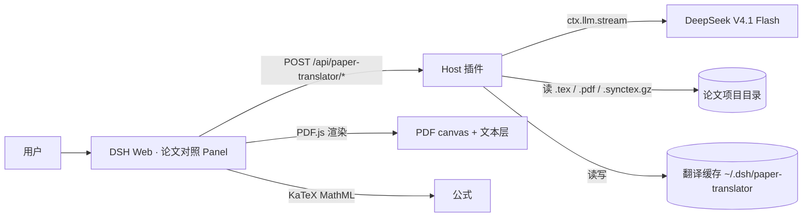

# DSH 论文对照翻译插件（PaperLens）设计方案

> 版本：v0.1 · 2026-11-11  
> 目标宿主：DeepSeek Harness Web GUI（profile `desktop`）  
> 翻译模型：DeepSeek V4.1 Flash（DSH 路由 `deepseek-official / deepseek-flash`）  
> 工作名：PaperLens / 论文对照  
> 实现状态：v0.1 已落地（Host 路由、LaTeX 解析、DeepSeek 翻译、缓存、PDF 面板、编译、include 展开）。当前未完成的是真实模型/浏览器内的最终联调与视觉验收。

---

## 1. 目标与非目标

### 1.1 目标

做一个 DSH 的**常驻 Web 插件**，在 Harness 主区域打开一个独立的“论文对照”页面：

- 左栏默认显示英文 LaTeX 论文正文的**中文译文**；
- 右栏默认显示对应的 **PDF**；
- 左右两栏的右上角各有一个分段按钮，可独立切换 `译文 / LaTeX / PDF`；
- 点击或滚动任一侧，另一侧定位到对应段落；
- 只翻译正文 prose，`\cite{}`、`\ref{}`、公式、命令、URL 不翻译；
- 源文件保存后，只重译发生变化的段落（增量、可缓存）；
- 翻译调用走 DSH 已配置的 DeepSeek V4.1 Flash，不需要用户在插件里再填一次 API Key。

### 1.2 v1 明确不做

- 不做完整的多文件 LaTeX 编辑器（v1 支持按 block 编辑中文/原始 LaTeX 片段，但不是全文件 IDE）。
- v0.1 已支持最多 4 层 `\input` / `\include` 展开（合并为一份虚拟源码，block 仍能映射回物理文件与文件内行号）；超过限制或循环引用会给出 warning。
- 不做 PDF 版面重排式翻译（不是 PDFMathTranslate 的路线）。
- 不做团队协作、批注同步、云端缓存。

---

## 2. 关键决策

| 决策点 | 选择 | 理由 |
|---|---|---|
| UI 宿主 | DSH Web 的 **全局 `main` keyed slot** + `sidebar.panellist` 入口 | 官方插件管理器就是这样做的；整页空间足够放双栏 |
| 前后端通信 | Host 注册 `ctx.connection.fetch.register()` 的 `/api/paper-translator/*` 精确路由 | 免去 Typert codegen；自带浏览器 Cookie 鉴权、Host/Origin 校验、owner-only、支持流式响应 |
| 模型调用 | Host 侧 `ctx.llm.stream()` | 凭证只在 Host；不暴露给浏览器；便于缓存、限流、重试 |
| 通信不走 iframe | 用 React 组件渲染在 slot 里 | DSH 规范明确禁止用 iframe 承载插件页面（会丢主题、locale、布局） |
| LaTeX 解析 | Host 侧轻量解析器，产出 block + placeholder | 前后端只维护一份解析逻辑；Client 只负责渲染 |
| PDF 渲染 | 浏览器端 PDF.js（随插件打包） | 需要 canvas、文本层坐标、滚动定位，`<embed>` 做不到 |
| 数学渲染 | KaTeX `output: 'mathml'` | 不依赖 KaTeX 字体文件；Chromium/WebKit 原生 MathML 足够 |
| 对齐 | SyncTeX 优先；文本锚点兜底；最后按页比例 | `.synctex.gz` 精确到行/坐标；没有时仍可近似同步 |
| 缓存 | 论文目录下的 sidecar（`main.paper-lens.json` + `.md`） | 跨重启、跨页面刷新、可随论文一起备份；按 block 内容 hash 命中 |
| 编辑 | 按 block 编辑中文或原始 LaTeX；保存后自动反向翻译并写回 `.tex` | 避免做完整 IDE；编辑粒度与 sidecar/对齐粒度一致 |

---

## 3. 总体架构



### 3.1 为什么翻译放在 Host

1. **凭证安全**：DeepSeek Key 在 Host 的 provider 配置里，浏览器永远拿不到。
2. **可缓存**：缓存写入磁盘，重开页面/重启 Harness 都能命中。
3. **可控制**：并发、限流、超时、重试、token 统计都在 Host 做。
4. **可复用**：以后加 CLI、Zotero、批量翻译，共用同一套引擎。

### 3.2 为什么不用 Typert Remote

DSH 的原生 RPC 需要 `@Remote` 装饰器 + 构建期生成的 descriptor，对独立插件来说工具链太重。`connection.fetch` 的精确路由同样经过浏览器鉴权与 owner 校验，且返回标准 `Response`，足以支撑本插件的 6 个接口。

> **本机已验证**：`plugin_manager install_bundle` 返回 `application: applied`，插件行 `include:paper-translator` 为 `fiberPhase: active`，说明 `ctx.connection.fetch.register()` 与 Host 路由在当前 DSH 版本可用；缓存目录也被成功创建。仍需在浏览器里做一次真实路由调用与视觉验收。如果别的 DSH 版本没有这个接口，退路是 `ctx.webServer.register` + 一次性 token（通过 `webserver/index-inject` 注入页面），或改用官方 Typert Remote。

---

## 4. DSH 集成方式

### 4.1 Bundle 结构

```text
paper-translator-plugin/
  package.json
  cordis.patch.yml
  index.js                 # Host 入口（纯 ESM，无第三方运行时依赖）
  client.js                # 构建产物（IIFE，内含 PDF.js / KaTeX）
  shared/                  # 前后端共享的纯函数（可选，构建时内联）
  src/
    host/                  # 解析、翻译、缓存、编译
    client/                # React 组件（JSX）
  assets/pdf.worker.mjs
  locale/en.json
  locale/zh.json
  icon.svg
  README.md
```

`package.json` 关键字段：

```json
{
  "name": "@local/paper-translator",
  "version": "0.1.0",
  "private": true,
  "type": "module",
  "exports": {
    ".": "./index.js",
    "./client": "./client.js",
    "./locale/*.json": "./locale/*.json",
    "./icon": "./icon.svg"
  },
  "files": [
    "index.js", "client.js", "cordis.patch.yml",
    "locale/*.json", "icon.svg", "assets/pdf.worker.mjs", "README.md"
  ],
  "dsh": {
    "bundle": { "patch": "./cordis.patch.yml" },
    "client": {
      "platform": "web",
      "immediately": true,
      "inject": ["@deepseek-ai/dsh-client-ui-layout"]
    }
  }
}
```

`cordis.patch.yml`：

```yaml
- insert:
    - id: paper-translator
      name: '@local/paper-translator'
      config:
        provider: deepseek-official
        model: deepseek-flash
```

安装方式：`plugin_manager` 的 `install_bundle` 指向本目录绝对路径；需要用户批准。安装完成后通过 `cordis_inspect_query` 确认 row 已激活，再打开页面验证。

### 4.2 Host 入口

```js
// index.js
export const inject = ['llm', 'connection', 'webServer', 'directoryPicker']

export function apply(ctx, config = {}) {
  const cfg = {
    provider: 'deepseek-official',
    model: 'deepseek-flash',
    targetLanguage: 'zh-CN',
    maxBatchChars: 2400,
    concurrency: 2,
    maxOutputTokens: 4096,
    ...config,
  }

  const projects = new Map()   // projectId -> { root, mainFile, blocks, parsedAt }

  ctx.effect(() => {
    const offTranslate = ctx.connection.fetch.register({
      path: '/api/paper-translator/translate',
      methods: ['POST'],
      requestBody: 'buffered',
      fetch: (request) => handleTranslate(ctx, cfg, projects, request),
    })
    const offOpen = ctx.connection.fetch.register({ /* /open */ })
    // ... 其余路由
    return () => { offTranslate(); offOpen() }
  }, 'paper-translator: HTTP routes')
}
```

> 注意：如果 `ctx.connection` 在某个 profile 里不存在，插件应保持不激活而不是抛错。可用 `ctx.inject(['llm', 'connection'], ...)` 包住注册逻辑。
>
> 另一个防御：把 `register()` 返回的 disposer 收进插件自己的 `ctx.effect`，这样即使 `registerFetchRoute` 内部把 owner 绑到了 connection 服务而不是本插件，插件卸载时也能主动摘掉路由。handler 里再加一个 `alive` 标志，卸载后统一返回 404，避免残留路由访问已释放的状态。

### 4.3 Client 入口：主面板 + 侧栏入口

这是整个插件最关键的一段注册代码，模式直接来自 DSH 自带的 Plugins 页面：

```js
window.__ModuleLoader__.load({
  id: '@local/paper-translator',
  factory(require) {
    const React = require('react')
    const en = { /* locale/en.json */ }
    const zh = { /* locale/zh.json */ }

    function PaperTranslatorPage() { /* 双栏 UI */ }
    function PaperTranslatorIcon() { /* 16px 图标 */ }

    return {
      inject: ['slots', 'locale'],
      apply(ctx) {
        ctx.effect(
          () => ctx.locale.register('paperTranslator', { en, zh }),
          'paper-translator: locale',
        )

        ctx.slots.inject('main', () => ctx.slots.register({
          name: 'main',
          key: 'paper-translator',
          locale: 'paperTranslator',
        }, PaperTranslatorPage))

        ctx.slots.inject('sidebar.panellist', () => ctx.slots.register({
          name: 'sidebar.panellist',
          id: 'paper-translator',
          order: 20,
          label: () => '论文对照',
          locale: 'paperTranslator',
        }, PaperTranslatorIcon))
      },
    }
  },
})
```

用户点击侧栏图标后，shell 会通过 `ctx.layout.selectPanel('paper-translator')` 把主区域切到本页面；页面本身不需要再调 `selectPanel`。

> `label` 的本地化方式以 M0 实测为准：若该 slot 的 label 不经过 locale，就改成中英双写或从 `ctx.locale` 取当前语言。`main` 若要求 `store`，按 Plugins 页面的最小 store 模式补一个即可。

### 4.4 视觉规范

- 容器、边框、文字、hover 只用 `--dsw-alias-*` 主题 token；不写死颜色。
- 顶部留出 `--dsh-frame-top-clearance`（macOS 48px / Windows caption 高度），避免被窗口控件压住。
- 分栏拖拽条、分段按钮、下拉菜单的交互与 DSH 现有控件一致（`role="switch"`、`aria-checked`、Esc 关闭等）。
- 文案全部走 `ctx.locale`；中英双语。
- 图标用自制 SVG（双栏 + “文”字意象），不超过 256 KiB。

---

## 5. 文档模型与 LaTeX 解析

### 5.1 Block

解析器把 `.tex` 切成“可翻译块”，每块保留源位置与占位符：

```json
{
  "id": "b_3f2a91c7",
  "kind": "paragraph",
  "section": "3.2 Ablation Study",
  "text": "We evaluate ⟦M1⟧ on ⟦C2⟧ and report the results in ⟦R3⟧.",
  "source": "We evaluate $\\alpha$ on \\cite{zhang2024} and report the results in \\ref{tab:ablation}.",
  "line": 214,
  "endLine": 219,
  "placeholders": [
    { "token": "⟦M1⟧", "type": "math", "latex": "\\alpha", "display": false },
    { "token": "⟦C2⟧", "type": "cite", "key": "zhang2024" },
    { "token": "⟦R3⟧", "type": "ref", "key": "tab:ablation" }
  ]
}
```

`kind` 取值：`title`、`section`、`paragraph`、`item`、`caption`、`abstract`、`keywords`、`biography`、`table-caption`、`footnote`、`theorem`、`proof`、`algorithm-caption`。

### 5.2 解析规则

**翻译**：

- 正文段落、章节标题、列表项、图/表 caption、abstract、footnote；
- `\textbf{}` / `\emph{}` / `\textit{}` 内的文字（v1 拍平，不保留样式）；
- `\caption{}`、`\section{}`、`\paragraph{}` 的参数；
- `quote`、`theorem`、`proof` 环境里的 prose；
- IEEEtran 的 `IEEEkeywords`、`IEEEbiography` / `IEEEbiographynophoto` 正文、`IEEEproof`；biography 的 optional photo 和 `{Author}` 参数不会进入正文，作者名放进 section 作为上下文；
- `\IEEEPARstart{T}{his}` 还原为 `This`，`\sep` 还原为逗号。

**不翻译**：

- 导言区（第一个 `\begin{document}` 之前）；
- `\newcommand` / `\def` / `\renewcommand` 的定义体；
- 数学环境：`equation`、`align`、`gather`、`multline`、`eqnarray`、`IEEEeqnarray`、`\[...\]`、`$$...$$`、`$...$`、`\(...\)`；
- `\label`、`\url`、`\bibliography` 等纯 key/路径参数；
- `\begin{figure}` / `\begin{table}` / `\begin{algorithm}` 的浮动体内部（caption 除外）；
- `tikzpicture`、`lstlisting`、`verbatim`、`minted`；
- 参考文献环境 `thebibliography`；
- `%` 注释（默认不翻译）。

**关键区分：行内命令 vs 环境**。`\cite{key}`、`\ref{key}`、`\eqref{key}`、`\href{url}{text}` 这类**只把命令本身替换成占位符**，命令前后的正文照常翻译；`\href` 只保护 URL，`{text}` 仍翻译。数学环境、figure/table/algorithm、tikz 等**整块跳过**。

**v1 的保守策略**：遇到不认识的命令/环境，**整块跳过**并在 UI 标记“未解析”，而不是硬拆。这样宁可不翻，也不破坏结构。

**解析器必须处理的转义**：`\%`、`\{`、`\}`、`\$`、`\&`、`\_`、`\#`、`\\`（换行）、`~`（不断行空格）。这些不能当成注释/命令边界。

### 5.3 占位符

格式：`⟦M1⟧`、`⟦C2⟧`、`⟦R3⟧`、`⟦U4⟧`、`⟦F5⟧`（M=math，C=cite，R=ref，U=url，F=footnote）。

- 用罕见的 Unicode 括号，降低与正文冲突的概率；
- 每个占位符在译文里必须**恰好出现一次**，token 集合与源文一致；翻译语序可能自然移动引用/公式，因此不再强制相对顺序不变；模型在 `⟦ M1 ⟧` 中插入的空白会先归一化；
- 校验失败 → 重试一次 → 仍失败则回退原文并标记，不写缓存。

### 5.4 大小限制

- 单文件 ≤ 2 MB；
- 单块 ≤ 4000 字符（超长段落按句号切分）；
- 总块数 ≤ 800；
- `\input` / `\include` v1 只提示“检测到多文件，暂不支持”，不递归读取。

---

## 6. 翻译管线

### 6.1 流程

```text
打开项目
  → 解析 .tex（Host）
  → 返回 blocks[] 与 outline
  → Client 按 block 渲染原文占位
  → 分批 POST /translate（每批 4~6 块，≤2400 字符）
  → Host 查缓存
      → 命中：直接返回
      → 未命中：ctx.llm.stream 调用 DeepSeek
  → 校验 JSON / 占位符 / 中文比例
      → 失败：带错误重试一次
      → 成功：写缓存，返回
  → Client 增量替换译文，KaTeX 渲染公式
```

### 6.2 Prompt

**System**（固定，约 500 tokens）：

```text
You are a professional academic translator working on LaTeX papers.
Translate the English prose of each block into Simplified Chinese.

Rules:
1. Return JSON only: {"translations":[{"id":"...","text":"..."}]}
2. Keep every placeholder such as ⟦M1⟧, ⟦C2⟧, ⟦R3⟧ exactly as-is,
   exactly once, and in the original relative order.
3. Never translate, add, or remove LaTeX commands, math, citation keys,
   labels, or URLs. Do not wrap the output in Markdown or code fences.
4. Do not explain, summarize, or add information.
5. Use formal academic Chinese. Preserve terminology and logical connectives.
6. If a term is ambiguous, keep the English term in parentheses on first use.

Glossary (use these translations consistently):
{glossary}

Paper context:
Title: {title}
Section: {section}
Previous paragraph (source): {prevSource}
```

**User**：

```json
{
  "targetLanguage": "zh-CN",
  "blocks": [
    { "id": "b_3f2a91c7", "kind": "paragraph", "text": "We evaluate ⟦M1⟧ on ⟦C2⟧ ..." }
  ]
}
```

### 6.3 校验

```js
const tokens = s => [...s.matchAll(/⟦[A-Z]\d+⟧/g)].map(m => m[0])

function validate(block, translated) {
  if (!translated || translated.length < 2) return 'empty'
  const src = tokens(block.text), out = tokens(translated)
  if (out.length !== src.length) return 'placeholder-count'
  if (out.length !== src.length) return 'placeholder-count'
  if (!sameMultiset(src, out)) return 'placeholder-mismatch'
  if (/\\[a-zA-Z]+/.test(translated)) return 'latex-command-leak'
  // 公式/引用占满的段落，中文占比天然低，跳过语言比例检查
  if (src.length / Math.max(1, block.text.length) < 0.1 && cjkRatio(translated) < 0.15)
    return 'not-chinese'
  const ratio = translated.length / block.text.length
  if (ratio < 0.25 || ratio > 2.8) return 'length-outlier'
  return null
}
```

失败处理：把错误原因附在第二次请求里，要求模型修正；仍失败则该 block 返回 `error`，UI 显示“翻译失败，点击重试”，源文不受影响。

### 6.4 缓存

- key：`sha256(promptVersion + model + targetLang + glossaryHash + block.text)`
- 位置：论文目录下 `main.paper-lens.json`（sidecar，权威缓存）与 `main.paper-lens.md`（人读译文）
- 结构：

```json
{
  "version": 1,
  "model": "deepseek-flash",
  "prompt": "p1",
  "entries": {
    "9f2c...": { "text": "我们在 ⟦C2⟧ 上评估 ⟦M1⟧……", "ts": 1760000000 }
  }
}
```

- 写入：debounce 1.2s，临时文件 + rename 原子写；每批翻译完成后主动 flush；
- 旧 `$DSH_HOME/paper-translator/cache/*.json` 的条目会在首次打开时按 cacheKey 合并进 sidecar，避免升级后一次性重译；
- 打开项目时 Host 直接把 sidecar 命中的译文放进 `translations` 响应，Client 不再对已缓存 block 发 `/translate`；
- “重新翻译本文”会带 `bypassCache: true`，但仍写新结果。

### 6.5 模型参数

| 参数 | 值 | 说明 |
|---|---|---|
| provider | `deepseek-official` | DSH 的 DeepSeek provider |
| model | `deepseek-flash` | V4.1 Flash；允许 config 覆盖 |
| thinking | 关闭（若该路由支持 `off`） | 翻译不需要推理链，省时省钱 |
| temperature | 0.3 | 稳定术语 |
| maxTokens | 4096 / 批 | 单批 4~6 块足够 |
| 并发 | 2 | 避免限流；可配置 |
| 单请求超时 | 60s | 若 `stream()` 不接受 signal，则中断异步迭代器；以 M2 实测为准 |
| 重试 | 429/5xx 指数退避 2 次；校验失败 1 次 | 不无限重试 |

启动时用 `ctx.llm.listModels('deepseek-official')` 检查 `deepseek-flash` 是否在目录里；不在则回退到目录中第一个文本模型，并在 UI 顶部提示实际使用的模型。

> 模型 id 以运行时目录为准：如果这个 DSH 版本暴露的是 `deepseek-v4.1-flash`（或别的别名），只改 `config.model`，不要改代码。

### 6.6 用量与成本

- 从 `usage` 块（终止 `finish` 之前）读取 prompt/completion tokens，累加后显示在页脚。
- 一篇 8k 词的论文约 12k 输入 tokens、10k 输出 tokens；分批上下文开销约 30~50k tokens；Flash 成本很低，首次全译通常 1~3 分钟。
- 命中缓存后重开页面 < 500ms。

### 6.7 合规性说明

翻译请求是**辅助模型调用**，不属于任何对话 turn，不会进入 Session 的模型上下文。v1 的做法：

- 不写 Session 事件；
- 在插件自己的缓存里保留请求/结果的 hash、token 数与时间戳；
- 不把论文全文写进日志。

如果 DSH 后续要求所有 model-visible 输入都可在 Session log 中重建，可切换到 `ctx.translator`（实验包，自带 Session 记录）或给当前 Session 追加 `plugin:` 记录。**这一点建议在实现前和 DSH 侧确认。**

---

## 7. 对齐与同步

### 7.1 三级对齐

1. **SyncTeX（首选）**  
   编译时带 `-synctex=1`，Host 用 `synctex view -i <line>:1:<file> -o <pdf>` 查询每个 block 起始行，得到 `{ page, x, y }`（单位 pt）。缓存 key：`pdfMtime + line`。  
   300 个 block 逐个起进程会偏慢，首次打开时按 4 并发预计算并落盘；若仍慢，再考虑直接解析 `.synctex.gz`。

2. **文本锚点（无 SyncTeX）**  
   PDF.js 取每页 `getTextContent()`，把 block 的前 6 个有效词做归一化匹配；命中后取该文本项的 transform 计算矩形。标记 `approx: true`。

3. **页比例（兜底）**  
   `page ≈ round(line / totalLines * pageCount)`，只用于滚动定位，不画精确高亮。

### 7.2 同步滚动

- 每侧用 `IntersectionObserver` 找“视口顶部附近”的 block；
- 若 `syncLock === false`，把另一侧滚到对应 block（LaTeX 滚到行，PDF 滚到页 + y）；
- 设置 150ms 的锁，避免双向滚动互相触发；
- 点击 block 会“钉住”选择：两侧同时高亮，直到下一次点击或滚动。

### 7.3 高亮

- LaTeX 侧：按 `line~endLine` 给行加背景；
- PDF 侧：用 block 的 `{page,x,y,w,h}` 在 canvas 上覆盖半透明矩形；
- 译文侧：给卡片加左边框/背景。

### 7.4 公式渲染

- 从虚拟源码（含 `preamble.tex`）抽取 `\newcommand` / `\renewcommand` / `\DeclareMathOperator` / `\def`，作为 KaTeX 的 `macros` 传给每次渲染；`\bm`、`\Bbb`、`\xspace` 有兼容别名。
- 渲染前清理 LaTeX 数学环境里的非数学命令：`\label`、`\nonumber`、`\notag`、`\tag`（转成 `\qquad\text{(...)}`）、`\intertext`、`\allowbreak`；`\operatorname*` 归一为 `\operatorname`。
- `align` / `gather` / `multline` / `eqnarray` 的正文自动包成 `aligned` / `gathered`，解决 `&` 对齐符在 KaTeX 里报错的问题。
- 输出用 KaTeX MathML；若仍失败，译文里显示虚线框 + 原始 LaTeX，不再静默空白。
- 实测当前论文 47 个公式（38 inline + 9 display）全部通过；修复前 9 个 display 里 8 个失败（`\label`、`\nonumber`、`\softplus`/`\sg`/`\pad` 宏、`align` 的 `&`）。

---

## 8. UI 设计

### 8.1 布局

```text
┌──────────────────────────────────────────────────────────────────────┐
│ 项目 ▾   main.tex ▾   DeepSeek V4.1 Flash   12/87   [重译] [编译] [⚙] │
├───────────────────────────────┬──────────────────────────────────────┤
│ 译文            [译文|LaTeX|PDF] │ PDF              [PDF|LaTeX|译文]     │
│                               │                                      │
│ ▍3.2 Ablation Study           │  ┌────────────────────────────────┐  │
│   我们在 ⟦C2⟧ 上评估 ⟦M1⟧……    │  │                                │  │
│   ……                          │  │        PDF.js canvas           │  │
│                               │  │                                │  │
│ ▍3.3 Implementation Details   │  │                                │  │
│   ……                          │  └────────────────────────────────┘  │
│                               │                                      │
├───────────────────────────────┴──────────────────────────────────────┤
│ 已翻译 34/87 · 缓存命中 12 · tokens 8.2k        [同步滚动 ☑] [交换]    │
└──────────────────────────────────────────────────────────────────────┘
```

- 分栏比例可拖拽，记忆在 localStorage；
- 每栏标题右侧是**独立**的三段切换（满足“左右都能切 LaTeX/PDF”）；
- 右栏 PDF 不存在时自动落到 LaTeX，并显示“编译 PDF”按钮；
- 左栏切到 PDF 时，右栏可切 LaTeX，形成任意组合。

**项目来源**：v0.1 提供两种方式——「选择目录…」调用 Host 的 `ctx.directoryPicker.capability()`：Desktop 走系统原生目录选择器（当前本机就是 `native`），选完自动找 `main.tex` 并打开；也可手动输入绝对路径 + `localStorage` 记住最近项目。远程/无原生选择器的组合会提示改用路径输入，应用内目录浏览待补。

### 8.2 状态

| 状态 | 表现 |
|---|---|
| 未选项目 | 居中空状态 + “打开论文” |
| 解析中 | 骨架屏 |
| 翻译中 | 每个 block 显示 shimmer；顶部进度条 |
| 单块失败 | 卡片底部“重试 / 显示原文” |
| 模型不可用 | 顶部横幅：原因 + “检查模型配置” |
| PDF 过期 | 右栏角标“PDF 可能不是最新”，点击编译 |
| 文件已保存 | 轻提示“检测到更新，已刷新 3 段” |

### 8.3 交互

- 点击 block：两侧定位 + 高亮；再次点击取消；
- 悬停 block：只做轻量高亮，不滚动；
- `Ctrl/Cmd + 滚轮`：缩放译文/PDF；
- 双击 PDF 文字：定位到 LaTeX 对应行（依赖反向 SyncTeX，缺失时退化为“定位到该页”）；
- 右上角 `⚙`：设置抽屉（术语表、目标语言、缓存清理、编译命令）。
- KaTeX 不认识的宏：原样显示 `$...$` 源码，不让整块渲染失败。

---

## 9. HTTP API

所有路径都在 `/api/paper-translator/` 下，只允许 owner Peer。Client 统一用 `fetch(url, { credentials: 'same-origin' })`，让浏览器的会话 Cookie 自动带上；POST 用 `Content-Type: application/json`。

| 方法 | 路径 | 请求 | 响应 |
|---|---|---|---|
| GET | `/health` | — | `{ ok, provider, model, models[] }` |
| POST | `/directory/pick` | `{}` | `{ kind: 'native' \| 'browse', path }` |
| POST | `/project/open` | `{ root, mainFile }` | `{ projectId, source, blocks, outline, pdf, synctex }` |
| POST | `/project/refresh` | `{ projectId }` | `{ changed, blocks, pdf }` |
| POST | `/translate` | `{ projectId, target, blocks, context, bypassCache? }` | `{ results:[{id,text,cached,usage?,error?}], usage, totals, globalTotals }` |
| POST | `/block/rewrite` | `{ projectId, blockId, chineseText? \| englishSource?, glossary? }` | 序列化项目 + `rewrittenBlockId` + `translations` + `translationError?` |
| POST | `/rebuttal` | `{ projectId, text, target: 'zh-CN' \| 'en', glossary? }` | `{ target, segments, matches, usage, totals, globalTotals }`（单审稿人，只读分析） |
| POST | `/rebuttal/overview` | `{ projectId, reviewers:[{id,name,text}], target }` | `{ summary, reviewers, overlaps, unique, usage, totals, globalTotals }`（多审稿人总览） |
| POST | `/block/polish` | `{ projectId, blockId, mode: 'zh' \| 'en', text, glossary? }` | `{ englishSource, usage, totals, globalTotals, skill }`（只预览，不写文件） |
| POST | `/align` | `{ projectId, blocks:[{id,line,text}] }` | `{ anchors:{ [id]:{page,x,y,w,h,approx} } }` |
| POST | `/compile` | `{ projectId }` | `{ ok, pdfMtime, synctex, logTail }` |
| GET | `/pdf` | `?projectId=` | `application/pdf` bytes |
| GET | `/stat` | `?projectId=` | `{ texMtime, pdfMtime, exists }` |
| GET | `/asset/pdf.worker.mjs` | — | PDF.js worker 脚本 |

> worker 文件必须与打包进 `client.js` 的 `pdfjs-dist` 版本**完全一致**，否则 PDF.js 会拒绝启动；构建脚本从 `node_modules/pdfjs-dist/build/` 直接拷贝到 `assets/`。

`project/open` 的 Host 侧行为：

1. 校验 `root` 是绝对路径、存在、包含 `mainFile`；
2. `realpath` 后确认 `mainFile` 在 `root` 内（防 `..` / symlink 逃逸）；
3. 读 `.tex`，解析；
4. 找同名 `.pdf`、`.synctex.gz`；
5. 生成 `projectId = sha1(root + '\0' + mainFile).slice(0,12)`，放入 LRU（最多 8 个项目）。

`/translate` 的 `blocks` 只包含 `id/text/kind`，不传 `source`（减少 body）；Host 用 `projectId` 里的解析结果做占位符校验。

### 9.1 编译 PDF

- 优先 `latexmk -pdf -interaction=nonstopmode -synctex=1 -file-line-error`；
- 没有 `latexmk` 时回退 `tectonic -X compile --synctex`，再回退 `xelatex -synctex=1`；
- 只有“编译 PDF”按钮或显式配置 `autoCompile: true` 才执行，不在每次保存时自动跑；
- `spawn` 不经过 shell，cwd 为项目根，120s 超时后 kill 进程组；
- 编译前把现有 `main.pdf` 备份为 `main.pdf.bak`，失败时恢复，避免把可用的旧 PDF 弄坏；
- 返回最后 80 行日志；失败时 UI 可展开查看。

### 9.2 双向编辑与写回

- 双击译文块（或点块底部「编辑」）打开模态；模态顶部再选择「编辑中文 / 编辑英文」，切换时两个草稿都保留。中文编辑走 `POST /block/rewrite` 的 `chineseText`，英文编辑走 `englishSource`；源码栏双击某行直接进入英文编辑。
- 编辑框内「用 Best-Paper-Writing 润色」调用 `POST /block/polish`，使用 vendored `skills/best-paper-writing/POLISH.md`（上游 v1.2，CC BY 4.0）。英文模式润色原始 LaTeX 片段；中文模式先译成英文再润色。结果只填回编辑器、不写文件；`/block/rewrite` 仍负责最终写回。润色会校验 LaTeX 命令/公式/引用/数字多重集合不变，失败重试一次。
- 中文 → 英文：
  1. 校验中文里的 `⟦M1⟧` 占位符数量/顺序必须与 block 一致；
  2. 用 `translateBatch`（`sourceLanguage: zh-CN`、`targetLanguage: en`）把中文译成英文占位符文本；
  3. `reconstructSource()` 把 `⟦M⟧` 还原成 `$...$`、`⟦C⟧` 还原成 `\cite{...}`，并按 block 类型补回 `\section{}` / `\caption{}` / `\item` 外壳；
  4. 在物理文件里定位原 `block.source`（按文件内行号就近匹配），替换并原子写入；
  5. 重新解析项目，把新 block 的 sidecar 映射设为编辑后的中文，刷新 Markdown。
- 英文 → 中文：直接写入原始 LaTeX，再重新解析并调用 EN→ZH 翻译，写入 sidecar；翻译失败会保留英文源并返回 `translationError`。
- 写回失败/重新解析找不到新 block 时，恢复原文件，避免把论文写坏。
- 限制：中文编辑会简化段落内 `\textbf{}`、`\emph{}` 等格式（v1 只保留公式/引用/URL）；要保留格式请用英文原始片段编辑。

### 9.3 PDF 缩放

- 右上角 `− 100% +` 工具栏；100% = 适应栏宽，点击百分比重置；范围 50%–300%，存 localStorage。
- 触摸板捏合：原生 `wheel`（`ctrlKey`）与 Safari `gesturestart/gesturechange/gestureend`；鼠标 `Ctrl/Cmd + 滚轮`；键盘 `Cmd/Ctrl + = / - / 0`。
- PDF 页面按 `zoom` 重新计算 render scale，而不是 CSS 拉伸；canvas 分辨率按 `devicePixelRatio` 与 3000px 上限取比例，兼顾清晰度和显存。
- 横向超出时 PDF 容器双轴滚动；缩放改变后按新尺寸重排页面，滚轮/工具栏共享同一个 App 级 `pdfZoom`。
- PDF 容器用 `ResizeObserver` 监听宽度（隐藏/展开左侧导航栏、拖拽分栏、窗口 resize），把 `containerWidth` 传给每个页面重新计算 fit width，避免侧栏隐藏后 PDF 仍停在旧尺寸。
- 插件 header 的 `padding-top` 叠加 DSH 的 `--dsh-frame-top-clearance`（Darwin 48px / Windows titlebar 高度），侧栏隐藏、面板贴到窗口左上角时内容落到红黄绿按钮下方；这是 DSH 宿主页面 pageHead 的同款做法。

### 9.4 多审稿人返修意见与总览

- 抽屉采用 `head + tabs` 固定、`pt-rebuttal-body` 独立滚动（`flex:1; min-height:0; overflow:auto`）；关闭按钮、审稿人编号/标签和总览入口不会随长内容滚走。
- 客户端维护 `reviewers:[{id,name,text,target,result}]` 和 `overview`，按项目存 localStorage `version:2`；旧版单审稿人 `{text,target,result}` 自动迁移为 Reviewer 1。每位审稿人独立调用 `POST /rebuttal`（`{projectId,text,target,glossary?}`），返回带 `paragraph` 的 segments/matches；pin 同时带 reviewerId，显示为 `R1·2`。
- `POST /rebuttal` 把论文可翻译 block 的 `{id,section,kind,text}` 和按空行切分的 `paragraphs:[{index,text}]` 发给模型；模型返回 `{segments:[{text,paragraph,matchId?}],matches:[{id,quote,blockId,reason}]}`。`paragraph` 是 1-based，Host 要求每个输入段落至少有一个 segment，缺段/越界会重试。
- Host 侧校验：只接受论文里真实存在的 blockId、丢弃无效 match、清理悬空 matchId、要求译文非空；失败重试一次，仍失败返回 502。
- 每个 match 对应一个 block；浏览器用 match 序号同时渲染返修译文高亮和论文 block pin，点击后 `selectBlock`，实现一一对应定位。
- 浏览器按 `paragraph` 分组渲染 `<p>`，保留原文段落；旧版结果没有 `paragraph` 字段时，客户端会丢弃结果但保留输入，提示用户重新分析，避免把旧结果当成已分段。
- `POST /rebuttal/overview`（`{projectId,reviewers:[{id,name,text}],target}`）调用 `overview.js`：输出 `summary`、每审稿人的 `attitude/score/summary/evidence`、`overlaps`（>=2 reviewerIds）和 `unique`（单 reviewerId）。Host 校验 reviewer id 和 attitude，要求每位审稿人恰好出现一次；总览语言跟随设置里的目标语言。
- 总览明确要求只根据审稿人自己的语言判断态度；若文本混有作者 rebuttal，忽略作者辩护。结果只存浏览器 localStorage，不写论文文件；模型调用计入 sidecar 用量和全局 ledger。

### 9.5 Token 用量与费用

- `pricing.js` 内置 DeepSeek 官方 `deepseek-flash` 峰谷价（USD/1M tokens），按调用时刻的 UTC 高峰窗口选择价格；`cacheRead` 按 cache-hit，`input + cacheWrite` 按 cache-miss，`output` 按输出价。
- sidecar 增加 `usage: { input, output, cacheRead, cacheWrite, costUsd, calls }`，每次 `/translate`、`/block/polish`、`/block/rewrite` 的模型调用后累加；缓存清空不会清除已花费统计。
- `UsageLedger` 把同样的字段写到 `$DSH_HOME/paper-translator/usage.json`，跨论文累计；`projects[projectId]` 记录每篇论文的已入账值，`syncProject()` 只在 sidecar 大于该值时补差额，避免重复打开重复计数。
- 响应字段：本论文用 `usage`/`totals`，全局用 `globalUsage`/`globalTotals`；`/project/open`、`/project/refresh` 时先 sync 再返回。
- 底栏和设置抽屉显示 tokens 与 `$ / ¥` 估算；人民币按 `pricing.usdToCny` 折算，默认 7.2。
- 高峰窗口只按 UTC 工作日计算，未排除中国法定节假日，因此是估算值。

### 9.6 编译引擎

- 默认 `compileEngine: pdflatex`，连续跑 `compileRuns` 次（默认 2 次）以解析交叉引用；`cwd` 是项目根，复用本机 TeX Live/MacTeX 的模板、`.sty`、`.bbl` 和字体。
- `pdflatex` 缺失时才回退 `latexmk -pdf`、`tectonic`、`xelatex`。
- 编译前备份 `main.pdf`，失败恢复；成功后重新解析项目并刷新 PDF 面板。

---

## 10. 文件与缓存

```text
<论文目录>/
  main.paper-lens.json      # sidecar 缓存，按 block hash 索引
  main.paper-lens.md        # 中文 Markdown，保留公式/引用命令
$DSH_HOME/paper-translator/
  cache/                    # 旧版缓存，只用于一次性迁移
```

- sidecar 是论文目录里的普通文件，权限 0600/0644；可以随论文一起备份，也可以加入 `.gitignore`；
- 清空本文缓存 = 清空 sidecar 条目并删除 `.paper-lens.md`；UI 提供“清空本文缓存 / 全部缓存”；
- 旧 `$DSH_HOME/paper-translator/cache/` 在“清空全部缓存”时一并删除。

---

## 11. 安全与隐私

- 路由只允许 owner Peer；非 owner 返回 403；Host/Origin 由 DSH 的 `/api` 围栏校验。
- 所有文件路径先 `realpath`，再确认在项目根内；拒绝 `..`、绝对路径逃逸、符号链接逃逸。
- 只允许读 `.tex` / `.pdf` / `.synctex.gz` / `.bib`（`.bib` 仅用于术语/标题上下文，可选）。
- 单文件 2 MB、单请求 4 MB、PDF 50 MB 上限。
- 编译命令来自 Host 配置，不接受 Client 传入任意命令；`spawn` 不经过 shell。
- 论文正文只发给用户配置的 DeepSeek 路由；不写日志、不上传第三方。
- API Key 永远不出现在 Client bundle、localStorage 或网络响应里。

---

## 12. 性能与成本

| 场景 | 目标 |
|---|---|
| 打开 30 页论文 | 解析 < 300ms |
| 首次全译 | 1~3 分钟（并发 2） |
| 保存后增量 | 只译改动块，通常 < 5s |
| 重开页面（全缓存） | < 500ms |
| PDF 首屏 | < 1s（按页懒加载） |
| 滚动同步 | 60fps，无抖动 |

优化点：

- Client 只对首屏 + 滚动附近的 block 做完整渲染（IntersectionObserver 懒渲染），避免 300 个卡片一次性挂载；
- PDF 页面按 `IntersectionObserver` 懒渲染，离屏 canvas 释放；
- 翻译请求按“可见区域优先”排序，用户先看到正在读的部分；
- 解析结果与对齐结果在 Host 缓存，切换 pane 不重算。

### 12.1 测试计划

- **解析器单测**：准备 5 篇真实论文的 `.tex`，覆盖 `%` 注释、`\%` 转义、`$...$`、`align`、`\cite`/`\ref`、caption、itemize、`\input` 提示；快照对比 block 数量与文本。
- **校验器单测**：缺占位符、重复占位符、token 不匹配、语序换位（应接受）、模型输出 Markdown 代码块、模型夹带 `\cite{}`、空输出、非中文输出。
- **路由集成**：mock `ctx.llm.stream`，覆盖缓存命中/未命中、429 重试、超时、取消。
- **UI 冒烟**：安装 bundle → 打开面板 → 打开样例项目 → 翻译 3 段 → 切三种 mode → 检查 console 无 crash。
- **真实回归**：选一篇 8 页以上的 arXiv 论文，记录首次全译耗时、token、缓存命中率、对比原文的人工抽检 10 段。

---

## 13. 里程碑

| 阶段 | 内容 | 预估 |
|---|---|---|
| M0 | bundle 骨架、侧栏入口、空主面板、`/health`、安装验证 | 1~2 天（已完成） |
| M1 | 项目打开、LaTeX 解析、原文/LaTeX 栏、文件刷新 | 3~4 天（已完成，含 include 展开） |
| M2 | `/translate`、DeepSeek 接入、占位符校验、缓存、译文栏 | 3~4 天（已完成，待真实模型联调） |
| M3 | PDF.js、三态切换、SyncTeX/文本锚点、同步滚动与高亮 | 4~6 天（PDF.js/三态/近似同步已完成；SyncTeX 精确对齐待补） |
| M4 | 编译按钮、设置抽屉、术语表、i18n、图标、打包 | 2~3 天（编译/设置/术语表/图标已落地） |
| M5（可选） | 多文件 `\input`、面板内编辑、双语导出、批注 | 按需 |

单人全职约 **2~3 周** 可到 v0.1；M0 建议先做，用来验证 DSH 的 slot / route / 安装链路。

---

## 14. 风险与对策

| 风险 | 影响 | 对策 |
|---|---|---|
| LaTeX 解析漏块/错块 | 译文缺段或结构错 | 保守解析；未识别块标“未解析”；用 3~5 篇真实论文做回归 |
| 模型改坏占位符 | 公式/引用丢失 | 严格校验 token 集合 + 重试 + 回退原文；允许自然语序换位；绝不写坏缓存 |
| 没有 SyncTeX | 滚动定位不准 | 文本锚点兜底；UI 标注“近似定位” |
| PDF.js worker/CSP | PDF 不显示 | worker 由 Host 路由提供；失败时降级 `disableWorker` |
| 长文首次翻译慢 | 体验差 | 可见区域优先；并发 2；显示进度与预计时间 |
| 模型路由不可用 | 无法翻译 | 启动时检查 `listModels`；UI 明确提示；允许 config 改 model |
| DSH API 变动 | 插件失效 | 只用公开文档中的服务；M0 做最小验证；版本锁定 |
| 合规争议 | 辅助调用未入 Session log | 先确认策略；备选 `ctx.translator` 或 plugin records |

---

## 15. 待确认

1. **左右默认布局**：我按“左译文 / 右 PDF”设计；若你希望默认“左原文 LaTeX / 右译文”，只需交换两个 pane 的初始 mode。
2. **编辑粒度**：已支持按 block 编辑中文/原始 LaTeX；暂不做整文件 IDE，也不支持多 block 批量改写。
3. **是否支持 `\input` 多文件？** 我建议 v1 单主文件，v2 递归。
4. **PDF 是否自动编译？** 我建议默认复用已有 PDF + 手动“编译 PDF”，避免每次保存都跑 LaTeX。
5. **辅助模型调用是否需要写入 Session log？** 需要和 DSH 侧确认；这会影响 Host 的调用方式。
6. **目标语言** 是否只做简体中文？建议 config 支持 `zh-CN / zh-TW / en`，默认 `zh-CN`。
7. **术语表** 是否 v1 就要？建议 v1 提供手动术语表（JSON/表格编辑），自动抽取放 v2。

---

## 16. v0.1 实现状态

已落地：

- Host bundle 与 `cordis.patch.yml`；`plugin_manager install_bundle` 安装成功，row `include:paper-translator` 为 `active`。
- 11 个 `/api/paper-translator/*` 路由（health / directory.pick / project.list / project.open / project.refresh / stat / translate / compile / pdf / asset / cache.clear），外加公开的 `/paper-translator/pdf.worker.mjs`。
- LaTeX 解析器：section、paragraph、item、caption、abstract、math、figure/table caption、宏展开、转义、注释、`\input` 递归展开、物理文件映射。
- 翻译管线：`ctx.llm.prepareCall` + `prepared.stream`（`reasoningEffort: "off"`，失败回退普通 `stream`）、JSON 解析、占位符/中文比例/长度校验（标题/短 caption 放宽长度下限）、一次修复重试、按 block hash 写项目 sidecar。  
  **真实模型自测已通过**：`deepseek-official / deepseek-flash / reasoningEffort=off`，样例输出「我们提出 EvoGauss，利用结构化高斯世界模型 ⟦C1⟧ 进行占用预测。」，usage 256 in / 40 out，占位符完整保留。
- 浏览器面板：`main` keyed slot + `sidebar.panellist`；双栏独立 `译文 / LaTeX / PDF` 切换；译文卡片/公式/cite/ref 渲染；源码行号与高亮；PDF.js 懒渲染；滚动/点击近似同步；设置抽屉；编译按钮；「选择目录…」原生目录选择。
- 增量 sidecar：译文写到论文目录 `main.paper-lens.json`（权威缓存）与 `main.paper-lens.md`（人读）；`/project/open` 直接返回命中的 `translations`，Client 不再为已缓存 block 发请求；刷新后只对缺失/变更 block 调模型，并带上前后文与上一段译文；旧 `$DSH_HOME` 缓存首次打开自动迁移（`migrated: true` 只迁一次）。
  **迁移实测**：当前 CVPR 论文 108 blocks / 99 可译，sidecar 命中 96；`main.paper-lens.json` 31 KB、`main.paper-lens.md` 24 KB；仅 3 个短标题需要补译一次。
- 构建：esbuild 打包 PDF.js + KaTeX + 面板代码为 `client.js`，PDF worker 走 `/api/paper-translator/asset/pdf.worker.mjs`。

待完成/待验证：

- 用真实 DeepSeek V4.1 Flash 跑一遍完整论文（当前只跑过单段自测），确认 JSON 稳定性、占位符通过率、耗时与 token。
- 浏览器内视觉验收（主题、窄窗口、PDF 滚动）。
- SyncTeX 精确对齐；当前用行号比例 + 文本块近似。
- `\input` 展开的边界（注释内 `\input`、`\iffalse`、verbatim）。
- 术语表自动抽取（v0.1 只支持手动 JSON）。
- 中文编辑会简化段落内加粗/斜体；v1 用英文原始片段编辑规避。
- 编译暂不自动跑 BibTeX（`main.bbl` 已存在时没问题；缺失时需要先跑一次 bibtex 或用 latexmk）。

---

## 17. 最小验证清单（M0）

- [ ] bundle 能被 `plugin_manager install_bundle` 安装并激活；
- [ ] 侧栏出现“论文对照”图标，点击后主区域出现空面板；
- [ ] `ctx.connection.fetch.register` 的路由在插件禁用/卸载后确实不可访问（验证 owner 归属）；
- [ ] `main` slot 的组件能拿到主题与 locale，且不依赖任何 DSH Client 包；
- [ ] `ctx.llm.listModels('deepseek-official')` 能看到 `deepseek-flash`，并能完成一次 10 字翻译；
- [ ] 面板能调用 `/api/paper-translator/health` 并显示模型名；
- [ ] 卸载/禁用插件后路由释放、侧栏入口消失、无 console 报错；
- [ ] 亮色/暗色主题下文字与边框正常；
- [ ] 中英文 locale 切换正常。
